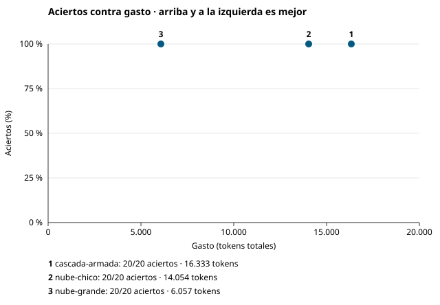

# Lab 1 · Decisión

## 1. Tabla de resultados

| Configuración | Aciertos | Inválidas | Tokens | Segundos | Costo estimado (USD) |
|---|---|---|---|---|---|
| cascada-armada | 20/20 | 0 | 16333 | 89.9 | 0.0 |
| nube-chico | 20/20 | 0 | 14054 | 51.3 | 0.0 |
| nube-grande | 20/20 | 0 | 6057 | 79.2 | 0.0 |

Modelos: nube-chico = `liquid/lfm-3-1.7b:free`; nube-grande = `nvidia/nemotron-3-ultra-550b-a55b:free`; cascada = chico y, si el chequeo no pasa, grande (armada desde las dos corridas).

## 2. Gráfico

Las tres configuraciones llegan al 100 % de aciertos (20/20), y el gasto del gráfico se mide en tokens totales. nube-grande queda más a la izquierda con 6.057 tokens, contra 14.054 de nube-chico (2,3 veces más) y 16.333 de la cascada (2,7 veces más), así que en tokens es mejor sin perder aciertos. No gana en todo: nube-chico fue la más rápida (51,3 s contra 79,2 s) y el costo estimado fue 0 USD en las tres.

## 3. Casos importantes

Las tres configuraciones coincidieron en la categoría de los 20 reclamos. No hubo desacuerdos de categoría; las diferencias aparecieron en la confianza declarada y, por eso, en el gasto. Analizo dos:

- Reclamo R19: nube-chico respondió `consulta` con confianza baja (1.644 tokens, 5,80 s); nube-grande respondió `consulta` con confianza alta (228 tokens, 2,26 s). La categoría esperada era `consulta`: ambos acertaron. La cascada escaló y sumó las dos llamadas (1.872 tokens, 8,06 s) sin cambiar la respuesta. Es ambiguo porque menciona un reembolso, pero pregunta si puede pedirlo y no reclama uno en curso; podría confundirse con `reembolso_pendiente`.
- Reclamo R20: nube-chico respondió `cobro_duplicado` con confianza baja (800 tokens, 2,29 s); nube-grande respondió lo mismo con confianza alta (551 tokens, 8,06 s). Ambos acertaron. La cascada gastó 1.351 tokens y 10,35 s para llegar a la misma categoría. Es ambiguo porque los cargos podrían corresponder a dos compras legítimas; sin revisar comprobantes no se confirma el duplicado y podría tratarse como `consulta`.

## 4. Regla de ruteo de modelos

| Tarea | Modelo o configuración | Por qué se elige | Riesgo y privacidad | Cuándo escalar |
|---|---|---|---|---|
| Clasificar reclamos donde importa la rapidez | nube-chico | 20/20 y menor tiempo total: 51,3 s | Este lab usa datos ficticios; con datos reales no enviar datos de tarjeta ni personales a un proveedor gratuito sin revisar su política de datos (LegacyPay está sujeta a PCI DSS) | Respuesta inválida o confianza baja: pasar a nube-grande |
| Clasificar en lote, sin urgencia, cuidando tokens | nube-grande | 20/20 con 6.057 tokens, el menor gasto | Igual que arriba; además, disponibilidad y límite diario del modelo gratuito | Respuesta inválida o confianza baja: revisión humana |
| Reclamos clasificados como `sospecha_fraude` | nube-grande y revisión humana | Acertó los 20 casos; en R17 declaró confianza baja, igual que nube-chico | Un error puede tener impacto económico; la decisión final no queda en el modelo | Siempre a una persona |

No adopto la cascada para esta tarea: no mejoró los aciertos y fue la que más tokens (16.333) y tiempo (89,9 s) usó.

## 5. Lo que el chequeo no verifica

No hubo ningún reclamo con confianza alta y respuesta equivocada, porque ninguno de los dos modelos falló (20/20 cada uno). Esto no demuestra que la confianza declarada sea confiable: son 20 reclamos ficticios y una sola corrida por modelo. El chequeo solo mira si la respuesta es válida y qué confianza declara el propio modelo; no comprueba que la categoría sea correcta. En esta medición nube-chico declaró confianza baja en 6 reclamos que acertó (R04, R09 y R17 a R20) y nube-grande en 1 (R17), de modo que las 6 escaladas agregaron 2.279 tokens y 38,6 s sin sumar aciertos.

Chequeo mejor propuesto: no depender solo de la autoevaluación. Contrastar la categoría con una señal independiente (reglas por palabras clave o un segundo modelo), enviar a revisión humana los desacuerdos y todo caso de `sospecha_fraude`, y medirlo sobre un conjunto etiquetado más grande, con más casos ambiguos. Su costo adicional todavía no está medido.

